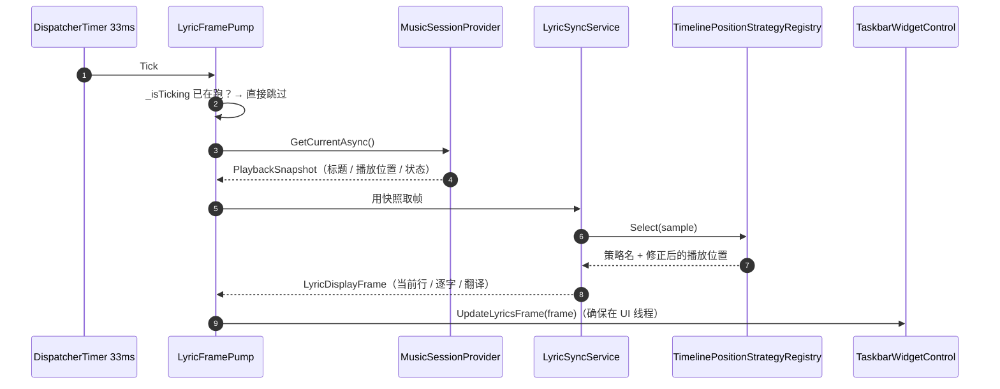
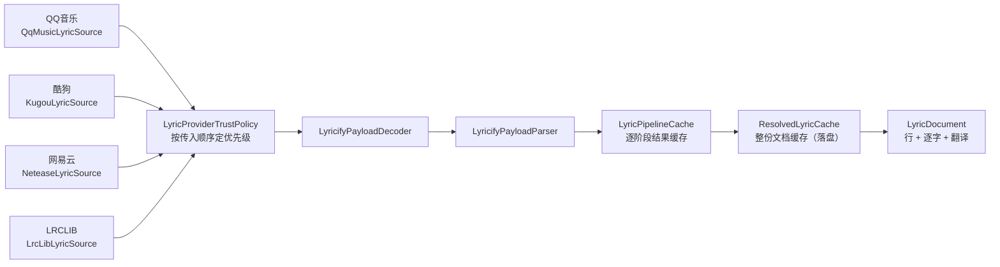
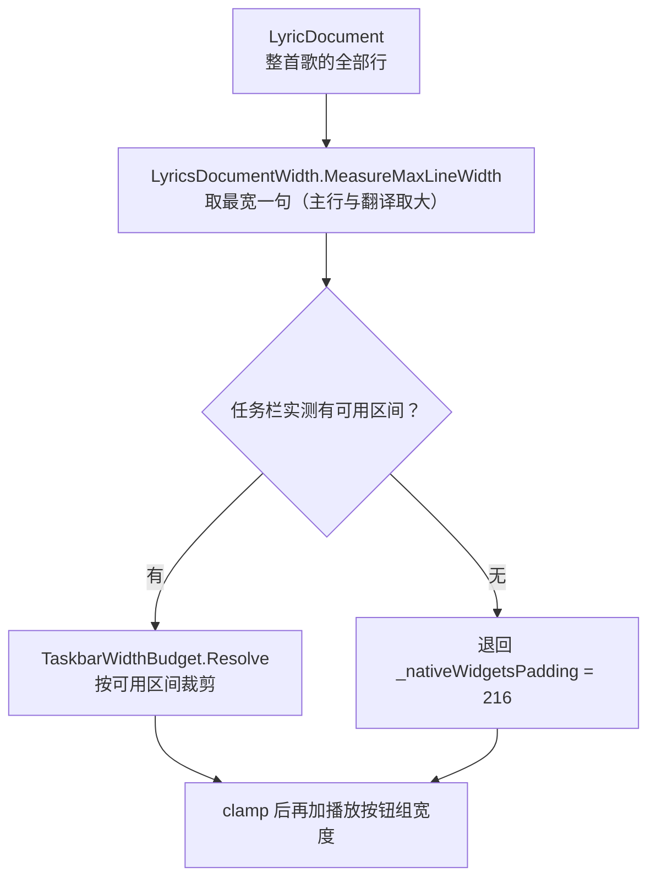

# 歌词功能架构

> 本文描述 `p3-native-render` 分支落地后的实际结构。每一处结论都指向具体文件；
> 改代码时请同步改这里，改不动就先确认是不是设计变了。

---

## 1. 三层，单向依赖

```
FluentFlyoutWPF/Controls/TaskbarWidgetControl.xaml.cs   渲染 —— 把一行字画进胶囊
        ▲
        │ LyricDisplayFrame / LyricDocument
        │
FluentFlyoutWPF/Lyrics/                                 适配 —— 定时器、线程、装配根
        ▲
        │
FluentFlyout.Lyrics/                                    Core —— 检索 / 解析 / 对齐 / 布局计算
```

依赖只朝下，不朝上：

- `FluentFlyout.Lyrics` **没有任何一处 `using System.Windows`**，也不引用 WPF 工程。
  所以检索、解析、时间轴、布局计算都不需要 UI 线程，可以直接断言
  （`FluentFlyout.Lyrics.Tests`，40+ 个测试文件）。
- 需要 Windows 的地方全部落在 WPF 工程里：SMTC 采样在
  `FluentFlyoutWPF/Lyrics/FluentFlyoutMusicSessionProvider.cs`，任务栏部件矩形的
  UIAutomation 测量在 `FluentFlyoutWPF/Windows/TaskbarWindow.xaml.cs`。Core 只认接口
  （`Abstractions.IMusicSessionProvider`）。

这条隔离是这次移植的地基：Core 若沾了 WPF，`TaskbarFreeSpaceLayout` /
`ScrollGeometry` / `LyricsDocumentWidth` 这类纯计算就再也测不了了。

---

## 2. 一次取帧的完整路径



三条硬约束，改动时别破坏：

| 约束 | 位置 | 破坏后果 |
|---|---|---|
| 同一时刻只允许一次取帧在跑 | `LyricFramePump.OnTimerTick` 的 `_isTicking` | 慢帧堆积成队列，切歌时一串过期帧依次闪过 |
| SMTC 采样同步调、不套 `Task.Run(...).GetResult()` | `LyricFramePump` 构造函数 | UI 线程去等线程池，COM 需要消息泵时会卡住 |
| 帧一律投递到 UI 线程再交渲染层 | `LyricFramePump.OnTimerTick` 的 `CheckAccess` / `BeginInvoke` | 在错误线程改可视树，随机 `InvalidOperationException` |

帧间隔是 `LyricFramePumpCore.DefaultInterval = 33 ms`（约 30 fps，够覆盖逐字歌词的推进）。
关掉歌词就 `Stop()` 停泵——空转的 33 ms 定时器意味着每秒 30 次跨进程 COM 调用。

**文档变更先于帧。** `LyricsService.OnFrameReady` 里先比 `_lastDocument`（按引用比）再
发 `DocumentChanged`，然后才发 `FrameReady`；渲染层要靠整份文档才能定下「这首歌固定多宽」，
顺序反了第一句会先按旧宽度排一次版。

---

## 3. 检索链路



装配点在 `FluentFlyoutWPF/Lyrics/LyricsService.cs` 的 `CreateCoordinator`。**顺序即优先级**，
不能随手调换：QQ音乐在前是因为它对中文曲目的逐字（QRC）覆盖最好；四个源的顺序与上游
TaskbarLyrics 的 `AppCompositionRoot` 保持一致，便于日后合并。

两级缓存分工不同，别混：

- `LyricPipelineCache` 缓存的是「某个源在某个阶段产出了什么」，用于失败重试时跳过已成功的阶段；
- `ResolvedLyricCache` 缓存的是「这首歌最终的文档」，换歌回来直接命中，不再发网络请求。

失败按异常类型分流（`LyricTransientFailurePolicy.IsTransient`）：网络类（超时、DNS、
连接重置、HTTP 5xx）可重试，鉴权类（`AuthenticationException`）不重试——重试只会
把同一次失败再演一遍。每次解析的结局都归到一个 `LyricSourceTerminalState`
（Succeeded / NoLyrics / IdentityRejected / Failed / TimedOut / Disabled / Canceled），
写进 trace 与诊断报告，所以「这首为什么没词」是可查的，不用靠猜。

---

## 4. 播放位置：四种策略与它们的选择顺序

`TimelinePositionStrategyRegistry.CreateDefault` 按顺序取第一个 `CanApply` 命中的策略：

| 顺序 | 策略 | 适用 |
|---|---|---|
| 1 | `LocalClockTimelinePositionStrategy` | 播放器根本不报时间轴（网易云、酷狗等时间轴恒 0） |
| 2 | `AppleMusicTimelinePositionStrategy` | Apple Music，有专门的量化与漂移处理 |
| 3 | `CommonExtrapolatedTimelinePositionStrategy` | 其余四家共用，按 AUMID 认播放器 |
| 兜底 | `DefaultExtrapolatedTimelinePositionStrategy` | 上面都不命中时朴素外推 |

**第 1 名不能挪。**「时间轴根本不可用」比「这是哪家播放器」更根本：若把 LocalClock 放到
`CommonExtrapolated` 之后，网易云会先被 AUMID 认出来命中后者，于是永远走不到本地时钟，
位置恒为 0、歌词不动。这条顺序写在 `TimelinePositionStrategyRegistry` 的类注释里，改前先读。

本地时钟需要一个「这首多长」才能回绕。SMTC 连 `EndTime` 都可能是 0，所以解析完成后
由 `LyricsService` 通过 `onTrackEndEstimateChanged` 把曲长推给
`FluentFlyoutMusicSessionProvider.SetTrackEndEstimate`，再落到注册表。判据
`LocalClockTimelinePositionStrategy.IsPlausibleTrackDuration` 只接受 ≥ 30 秒的估计值——
短于此的多半是「最后一行歌词的时间」而不是真实曲长，采信会让位置提前回绕。
下发时打一行 Info 日志说明采信与否，排查「单曲循环卡末行」时直接看这行。

注册表上还叠了一层**暂停保位**：用户按暂停的瞬间，播放器往往还会再报一两次旧时间轴，
位置继续前进几百毫秒、歌词多滚一句。`MaximumDeferredPausedAdvance`（1 秒）以内的前进
在状态切换确认前不予采纳；超过则认为用户拖了进度条，必须采纳。

---

## 5. 渲染：宽度、避让、竖向

宽度决策有三层，从内到外：



**为什么要按整首最宽句定宽，而不是按当前行。** 按当前行量宽度会让胶囊随每句胀缩，
长句还会先按窄宽度排好、再滚动、再变宽——用户看到的是持续抖动。整首固定一次算完，
代价是短句居左时右侧留白，可接受。

**单位链条容易看错，写清楚**（详见 `TaskbarWidgetControl.xaml.cs` 对应注释）：

```
216  ── 视觉 DIP，恒为 216，不随 DPI 变
 /_scale ── 布局 DIP，240
 ×dpiScale×_scale ── 占屏物理像素
```

所以 216 从来不是「物理像素预算」。把 UIAutomation 量到的物理坐标直接当预算传进来，
150% DPI 下会凭空多出 1.5 倍宽度。另外播放按钮组是**加在 clamp 之后**的，实测预算必须
先把按钮宽度扣掉再当上限，否则整块占位会超出可用区间整整一个按钮组。

避让由 `TaskbarFreeSpaceLayout.TryPlace` + `TaskbarWidthBudget.Resolve` 完成，
可用区间来自 UIAutomation 实测的任务栏部件矩形（`GetTaskbarWidgetRect` /
`GetSystemTrayRect`，带 500 ms 缓存）。测不到时才退回硬编码 216。

**两份 216 是同值不同义，故意不合并成一个常量**（`TaskbarWindow.xaml.cs` 与
`TaskbarWidgetControl.xaml.cs` 各一份）：前者是「量不到 Widgets 按钮位置时的**兜底偏移**」，
决定小组件从哪儿开始摆；后者是「量不到可用区间时的**文本预算兜底**」，决定文字最多多宽。
两者恰好都等于「原生小组件占的宽度」，但将来只调其中一个（比如某个任务栏皮肤下按钮更宽）
就会静默改坏另一个。真要统一，得先确认两者的变化时机永远一致——目前没有证据支持这一点。

竖向下不扣按钮宽度：竖向的预算方向是主轴（屏幕纵向），而按钮组经反向旋转后也是竖排，
它的位置由 `TaskbarWindow` 的 `crossPos` 居中处理，不在这个预算里——扣掉会让可用主轴
长度凭空少一个按钮组。

任务栏方位变了由 `TaskbarWindow` 调 `Widget.SetVerticalMode(isVertical)` 触发重排；
混合 DPI 由 `TaskbarWindow.xaml.cs` / `MainWindow.xaml.cs` 里的 `WM_DPICHANGED` 处理。

### 5.1 竖向折行宽度：装配链上唯一不会自愈的一环

竖向下 `LyricsPanel.Width` **必须由宿主写入**，值取 `CalculateSize` 返回的 `logicalHeight`
（40 / 28 DIP，与 `LyricsMetricsPolicy.DefaultTaskbarCrossSize` / `SmallTaskbarCrossSize` 同源）。

这一条之所以要单独写，是因为**断了不会有任何报错，只会「一个字都看不见」**：

```
面板根是 HorizontalAlignment=Left 的 UserControl，内容全在 Canvas 里
Canvas.MeasureOverride 恒返回 (0,0)
  → 放在 Width="Auto" 的横向 StackPanel（MainStackPanel）里，排列宽度 = 内容期望宽度 = 0
  → ActualWidth = 0 → ResolveVerticalViewport() = 0
  → UpdateVerticalWrapLayout() 首行早退，Container 高度停在 XAML 的值、TextBlock.Width 仍是 NaN
  → ClipToBounds=True 把文字整块剪掉
  → SizeChanged 不会来救：尺寸从 0 到 0 不触发
```

也就是说，**没有任何环会把宽度补上**。曾经 `CalculateSize` 用 `&& !_isVertical` 跳过这次赋值、
以为面板能从自身 `ActualWidth` 取到折行宽度，结果竖向任务栏整条路径静默失效
（顶部/底部正常，左侧/右侧空白）。视觉验收矩阵没抓到，因为那套夹具直接给面板写了宽度，
**绕过了生产路径的取宽度方式**——这也是「夹具通过 ≠ 真机通过」的一个具体案例。

运行期判据：日志里出现 `Vertical lyrics: wrap viewport is 0` 就说明这条链断了。
正常情况下它最多出现一次（首次布局前），随后被宿主写入宽度后的 `SizeChanged` 覆盖。

这条链现在还有一层自动化护栏：`TaskbarVerticalLyricsWiringTests` 在 STA 线程上构造
**真实的** `TaskbarWidgetControl`，按生产顺序（`SetLyricsMode` → `SetVerticalMode` →
`CalculateSize`）走一遍，断言 `LyricsPanel.Width` 落在 40 / 28 DIP（小任务栏 28）。
它盯的是「宽度有没有被写进去」，不是「排版好不好看」——后者仍归截图矩阵。
把 `ApplyVerticalLyricsPanelWidth` 那行注释掉，4 个用例里 3 个立刻红，说明这条护栏是有效的。

---

## 6. 生命周期：泵跟服务走，不跟窗口走

任务栏窗口会被反复重建——Explorer 重启、切屏、改设置、DPI 变化都会触发
`MainWindow.RecreateTaskbarWindow`。若帧泵跟着窗口走，每次重建都要重新装配检索链路：
丢掉已解析的歌词文档、重发一次网络请求、用户看到歌词闪一下。

所以 `LyricsService` 持有泵，窗口重建时只换「帧往哪送」。`Dispose` 的顺序也有讲究：

```
先停泵（不再产生新帧）→ 拆订阅 → 释放 syncService → coordinator → cache → offsetStore
```

反过来会让最后一次 Tick 撞上已释放的 `LyricSyncService`。

单曲偏移保存在 `TrackLyricOffsetStore`（SQLite，按「曲目 + 歌词源」定位）。读取走
`LyricSyncService` 的 `getTrackLeadTime` 回调**每帧现取**，所以拖完滑块下一帧就生效，
不需要任何失效通知——`LyricsService.NotifyOffsetChanged()` 因此是空实现，留着只是给
将来加缓存时留一个明确的失效点。

UI 入口有两处，都指向同一个值：设置页的歌词页，以及托盘菜单的
「调整当前歌曲偏移」（`MainWindow.xaml` 的 `NotifyIconLyricsOffset`，只在歌词模式生效时可见，
由 `UpdateLyricsTrayMenu` 控制）。

---

## 7. 文件索引

| 关注点 | 主要文件 | 单测 |
|---|---|---|
| 装配根 / 帧泵外壳 | `FluentFlyoutWPF/Lyrics/LyricsService.cs`、`LyricFramePump.cs` | `LyricFramePumpCoreTests` |
| SMTC 会话与时间轴采样 | `FluentFlyoutWPF/Lyrics/FluentFlyoutMusicSessionProvider.cs` | `SessionSelectionPolicyTests` |
| 播放位置策略 | `FluentFlyout.Lyrics/Timeline/*` | `TimelinePositionStrategyTests`、`LocalClockTimelineStrategyTests` |
| 检索与各源 | `FluentFlyout.Lyrics/Services.*`（平铺命名，非子目录） | `LyricResolutionCoordinatorTests`、`QqMusic*Tests`、`LyricifySourceAdaptersTests` |
| 缓存 | `LyricPipelineCache`、`ResolvedLyricCache`、`LyricCacheStore` | `LyricPipelineCacheTests`、`ResolvedLyricCacheTests`、`LyricCacheStoreTests` |
| 对齐与滚动 | `Layout/ScrollGeometry.cs`、`Layout/ScanGeometry.cs` | `ScrollGeometryTests`、`ScanGeometryTests` |
| 宽度与避让 | `Layout/LyricsDocumentWidth.cs`、`TaskbarFreeSpaceLayout.cs`、`TaskbarWidthBudget.cs` | `LyricsDocumentWidthTests`、`TaskbarFreeSpaceLayoutTests`、`TaskbarWidthBudgetTests` |
| 竖向布局 | `Layout/LyricsVerticalLayout.cs` | `LyricsVerticalLayoutTests` |
| 渲染控件 | `FluentFlyoutWPF/Controls/TaskbarWidgetControl.xaml(.cs)`、`LyricsPanel.xaml.cs` | 由上述布局单测覆盖 |
| 偏移持久化 | `Services.TrackLyricOffsetStore.cs` | `TrackLyricOffsetStoreTests` |
| XAML 图标名门禁 | `FluentFlyout.Lyrics.Tests/SymbolIconNameTests.cs` | 同文件 |

单帧耗时与分配量见 [perf-baseline.md](perf-baseline.md)；改名或调整调用链后重跑一次，
看「每帧 1.6 µs / 499 B」是否还在同一量级。

---

## 8. 已知边界

这些是**有意为之**的现状，不是待修缺陷；改动前请先确认需求是否真的变了。

- **本地 `.lrc` 未接入生产路径。** `Services.LocalLyricProvider.cs` 与
  `Services.LocalMediaIndex.cs` 已实现且有单测，但 `LyricsService.CreateCoordinator`
  只装配四个在线源。接进来需要先有「本地曲库目录」的设置项。
- **播放器级偏移恒为 0。** 只有曲目级偏移有 UI 入口。播放器级先给 0 是有意的：
  编造一个用户没设置过的偏移，会让「第一次用就对不上」比不修更难查。
- **逐字时间来自源站，不自己推算。** `Models.LyricSyllable` 里的音节时间就是源站返回的
  那份，没有做强制对齐（forced alignment）。
- **翻译来自源站。** 不做机器翻译；简繁转换由 `Utilities.ChineseScriptConverter.cs` 负责。